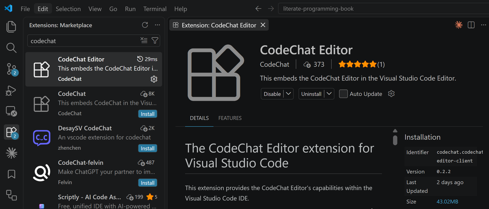

MSU class notes
===============

Week 13
-------

### Monday, 2026-Nov-16

1. [Homework](https://canvas.msstate.edu/courses/186065/assignments) - due
   today!
   1. This week: final class projects begin. Undergrads: work with international
      partners. Grad students: work on your project; submit your spec for review
      by Thursday.
   2. Use the latest project [assignment](project_2.md) and
      [template](project_2_submission_template.md).
2. Enable Capture when using the CodeChat Editor.
3. Dev notes: debugging.
   1. Claude created a patch based on a bug report, then identified major
      issues.
   2. Claude worked on fixing intermittent failures, but chose longer delays
      versus fewer tests in parallel.
4. Articles
   1. [How the Claude Code team does code review](https://claude.dev/blog/solving-code-review-at-anthropic)
   2. [Best practices for Claude Code](https://code.claude.com/docs/en/best-practices),
      [Codex](https://learn.chatgpt.com/guides/best-practices)
   3. [LLMs are making formal software verification feasible at a much larger scale](https://www.anthropic.com/research/formal-verification)
5. Examples of specs: htmd
   [headings](https://github.com/letmutex/htmd/blob/main/translation_approach.md#headings),
   [links](https://github.com/letmutex/htmd/blob/main/translation_approach.md#links),
   [images](https://github.com/letmutex/htmd/blob/main/translation_approach.md#images),
   [math](https://github.com/letmutex/htmd/blob/main/translation_approach.md#math);
   CodeChat Editor
   [cache spec](https://github.com/bjones1/CodeChat_Editor/blob/main/server/src/processing/cache-spec.md).
6. Discussion: lessons learned from spec development.

Project list:

1. Add CodeChat Editor support for collapsing headings -- each heading should
   have a collapse icon that appears next to it. Collapsing it should collapse
   everything under that heading, including subheadings, code blocks under that
   heading, etc. After collapse, the icon should change to an expand icon, allow
   users to expand the collapsed heading.

2. Add CodeChat Editor `<filetoc ref="id-of-a-heading"></filetoc>` tag which
   hydrates into a table of contents for the referenced heading and all its
   subheadings. See the
   [cache spec](https://github.com/bjones1/CodeChat_Editor/blob/main/server/src/processing/cache-spec.md)
   for examples of custom tags defined by the CodeChat Editor.

3. Add YAML support to htmd. Extend pulldown-cmark to render metadata blocks in
   YAML style as a `` tag in
   HTML; see
   [`ENABLE_YAML_STYLE_METADATA_BLOCKS`](https://docs.rs/pulldown-cmark/latest/pulldown_cmark/struct.Options.html#associatedconstant.ENABLE_YAML_STYLE_METADATA_BLOCKS).
   Add htmd support for changing it back to YAML.

4. Add the ability for a CodeChat Editor fragment to refer to a portion of a
   Markdown file; currently, fragments only work in source files. Define a
   method to specify what a fragment includes: everything in the current
   heading? Only text inside the fragment tag? Everything until a (new) end
   fragment tag? See
   [fragments](https://github.com/bjones1/CodeChat_Editor/blob/main/server/src/processing/cache-spec.md#fragments-and-gather-elements).

5. Enhance the CodeChat Editor cross-reference system, so that the target of
   [cross-references](https://github.com/bjones1/CodeChat_Editor/blob/main/server/src/processing/cache-spec.md#cross-references)
   includes links back to each referring cross-reference.

6. Enhance the CodeChat Editor by writing a new spec that causes the Editor to
   embed line number information in the HTML it sends to the Client: each line
   of Markdown in a source file or Markdown document should emit a
   `<l-n>24</l-n>` tag (with exceptions where this isn't possible -- inside code
   blocks, etc.) See <xref ref="cc-TB0Jxbo_gu"></xref> for an early prototype.

7. Develop a project group creation tool. This is a web app:

   1. The organizer <xref ref="cc-t95-jpUTgJ">authenticates with Teams</xref>
      then provides a list of all student userids to be placed in a project
      group and a second list of project names. The app produces a link the
      organizer posts, asking for students to specify preferences.
   2. Students click on the link, which takes them to the web app. They
      authenticate with Teams, then are given the ability to place projects into
      three categories: unspecified, preferred and not preferred; within the
      preferred/not preferred category, the projects can be ranked highest to
      lowest.
   3. Likewise, students can also rank potential teammates, using the same
      system.
   4. After students provide their preferences, the organizer can then ask the
      tool to form groups which best satisfy the criteria; the resulting group
      assignments, listing each student and their assigned group, can be
      downloaded as a `.csv` file (the input to the next project). Given $n$
      students, each group should have $\approx 1/n$ students.
8. Develop an app which enables team members to rate the performance of their
   teammates. This is a web app. See <xref ref="cc-NgJX8yVtOQ"></xref>.

   1. The organizer <xref ref="cc-t95-jpUTgJ">authenticates with Teams</xref>,
      then can:
      1. Create an evaluation: a series of questions, in which each question
         consists of Markdown text and a question type: text response or rating
         response. Questions can be added, deleted, edited, and reordered.
      2. Start an evaluation: select an evaluation, upload a `.csv` file (such
         as one produced by the previous project) which lists each student's
         userid and their assigned team, then produce a URL to post for students
         to access the evaluation.
      3. View evaluation results: select an evaluation, then see the results as
         described in <xref ref="cc-NgJX8yVtOQ"></xref>.
   2. Students click on an evaluation link, which asks them to authenticate with
      Teams then allows them to enter or modify (if they've submitted data
      earlier) the evaluation data, clicking "Submit" when done.

Week 11
-------

### Monday, 2026-Nov-02

1. [Homework](https://canvas.msstate.edu/courses/186065/assignments) - due
   Sunday! Week 1 of class projects. Collaborate with international partners.

2. Enable Capture when using the CodeChat Editor.

3. Article:
   [Recursive self-improvement](https://www.wsj.com/tech/ai/ai-anthropic-rsi-recursive-self-improvement-bff4e815).

4. Discuss [LLM use](LLM-use.md).

5. Available projects:

   1. [git-hints](https://github.com/bjones1/literate-programming-fall-2024/tree/git-tool)
      (see the `git-tool` branch in that repository).

   2. Add capabilities to [htmd](https://github.com/letmutex/htmd):

      1. Standardize testing of [htmd](https://github.com/letmutex/htmd) based
         on round-trip stability/idempotency (fork
         [my repo](https://github.com/bjones1/htmd), not upstream).
      2. Add a fuzzer for [htmd](https://github.com/letmutex/htmd) based on
         round-trip stability/idempotency.
      3. Add support for subscript.
      4. Create a pulldown-cmark / htmd live demo: like the CommonMark
         [demo](https://markdown.fastlylabs.com/), but allows HTML to Markdown
         or Markdown to HTML. Use the Rust
         [Leptos framework](https://leptos.dev/),
         [client-side rendering](https://book.leptos.dev/getting_started/index.html).

      Resources:

      * CommonMark [spec](https://spec.commonmark.org/0.31.2/) and
        [demo](https://spec.commonmark.org/dingus/)
      * GitHub-flavored markdown [spec](https://github.github.com/gfm/)
      * [Markdown guide](https://www.markdownguide.org/); see the
        [Extended Syntax](https://www.markdownguide.org/extended-syntax/) for
        many of the items below.
      * Pulldown-cmark
        [specs](https://pulldown-cmark.github.io/pulldown-cmark/specs.html),
        [docs](https://docs.rs/pulldown-cmark/0.13.4/pulldown_cmark/index.html),
        [options](https://docs.rs/pulldown-cmark/0.13.4/pulldown_cmark/struct.Options.html),
        and [demo](https://markdown.fastlylabs.com/).
   3. [dprint-plugin-markdown](https://github.com/dprint/dprint-plugin-markdown)
      (fork [my repo](https://github.com/bjones1/dprint-plugin-markdown.git),
      not upstream) support for:

      1. Heading attributes
      2. Superscript
      3. Subscript
      4. A ` ` starts a new line
      5. [Support indentation with tabs](https://github.com/dprint/dprint-plugin-markdown/issues/242)
         (see [Tabs](https://spec.commonmark.org/0.31.2/#tabs) in the CommonMark
         spec and an
         [existing PR](https://github.com/dprint/dprint-plugin-markdown/pull/253))
      6. [Add a fuzzer](https://github.com/dprint/dprint-plugin-markdown/pull/166)

      Resources:

      * dprint [manual](https://dprint.dev/) and
        [Markdown section](https://dprint.dev/plugins/markdown/) of the manual
      * CommonMark [spec](https://spec.commonmark.org/0.31.2/) and
        [demo](https://spec.commonmark.org/dingus/)
      * GitHub-flavored markdown [spec](https://github.github.com/gfm/)
      * Pulldown-cmark
        [specs](https://pulldown-cmark.github.io/pulldown-cmark/specs.html),
        [docs](https://docs.rs/pulldown-cmark/0.13.4/pulldown_cmark/index.html),
        [options](https://docs.rs/pulldown-cmark/0.13.4/pulldown_cmark/struct.Options.html),
        and [demo](https://markdown.fastlylabs.com/)

Week 10
-------

### Monday, 2026-Oct-26

1. [Homework](https://canvas.msstate.edu/courses/186065/assignments) - due
   Sunday! Week 2 of class projects.
2. Enable Capture when using the CodeChat Editor.
3. Discuss [LLM use](LLM-use.md).

Week 9
------

### Monday, 2026-Oct-19

1. [Homework](https://canvas.msstate.edu/courses/186065/assignments) - due
   Sunday! Week 1 of class projects.

2. Enable Capture when using the CodeChat Editor.

3. Discuss `git-hints` results.

4. Schedule

   | Week | Date   | Task          |
   | ---- | ------ | ------------- |
   | 9    | Oct 19 | Project 1     |
   | 10   | Oct 26 | Project 1     |
   | 11   | Nov 02 | Project 2     |
   | 12   | Nov 09 | Project 2     |
   | 13   | Nov 16 | Final Project |
   | 14   | Nov 23 | Final Project |
   | 15   | Nov 30 | Final Project |

5. Projects: add capabilities to [htmd](https://github.com/letmutex/htmd).
   Resources:

   1. CommonMark [spec](https://spec.commonmark.org/0.31.2/) and
      [demo](https://spec.commonmark.org/dingus/)
   2. GitHub-flavored markdown [spec](https://github.github.com/gfm/)
   3. [Markdown guide](https://www.markdownguide.org/); see the
      [Extended Syntax](https://www.markdownguide.org/extended-syntax/) for many
      of the items below.
   4. Pulldown-cmark
      [specs](https://pulldown-cmark.github.io/pulldown-cmark/specs.html),
      [docs](https://docs.rs/pulldown-cmark/0.13.4/pulldown_cmark/index.html),
      [options](https://docs.rs/pulldown-cmark/0.13.4/pulldown_cmark/struct.Options.html),
      and [demo](https://markdown.fastlylabs.com/):
      1. Footnotes (sbe80)
      2. Strikethrough (drj228)
      3. Task lists (raf322)
      4. Smart punctuation (ams2083)
      5. Heading attributes (jhg246)
      6. Definition list (jit45)
      7. Superscript (ewj55)
      8. Subscript

Week 8
------

### Friday, 2026-Oct-16

1. [Homework](https://canvas.msstate.edu/courses/186065/assignments) - due
   Sunday!
2. Enable Capture when using the CodeChat Editor.
3. [Grade calculator](exercises/grade-calculator.md) spec design exercise.

### Wednesday, 2026-Oct-14

1. [Homework](https://canvas.msstate.edu/courses/186065/assignments) - due
   Sunday!
2. Enable Capture when using the CodeChat Editor.
3. CodeChat Editor features: clone [htmd](https://github.com/letmutex/htmd).
   1. Creating a project.
   2. Adding entries to the table of contents.
   3. Adding a unique ID to headings.
   4. Cross-references.
   5. Creating fragments with a unique ID.
   6. Gathering fragments.

### Monday, 2026-Oct-12

1. [Homework](https://canvas.msstate.edu/courses/186065/assignments) - due
   Sunday! Will be released after today's class.
2. Enable Capture when using the CodeChat Editor.
3. Article:
   [Investigating unintended model actions in our evaluations and internal use](https://www.anthropic.com/research/investigating-unintended-model-actions).
4. Spec design for
   [git-hints](https://github.com/bjones1/literate-programming-fall-2024), on
   the `git-tool` branch.
5. Dev notes: recent
   [CodeChat Editor](https://github.com/bjones1/CodeChat_Editor) features.
   1. Clone this repo.
   2. View the following sections of CodeChat Editor manual (`README.md`):
      1. Cross-references
      2. Gathering fragments
   3. Look at the cache spec under Server / processing.rs section on Cache
      design.
6. CodeChat Editor features: clone [htmd](https://github.com/letmutex/htmd).
   1. Creating a project.
   2. Adding entries to the table of contents.
   3. Adding a unique ID to headings.
   4. Cross-references.
   5. Creating fragments with a unique ID.
   6. Gathering fragments.

Week 7
------

### Monday, 2026-Oct-05

1. [Homework](https://canvas.msstate.edu/courses/186065/assignments) - due
   Sunday! Will be released after today's class.
2. Enable Capture when using the CodeChat Editor.
3. Spec design for
   [git-hints](https://github.com/bjones1/literate-programming-fall-2024), on
   the `git-tool` branch.

Week 6
------

### Monday, 2026-Sep-28

1. [Homework](https://canvas.msstate.edu/courses/186065/assignments) - due
   Sunday! Will be released after today's class.
2. Enable Capture when using the CodeChat Editor.
3. Spec design for
   [git-hints](https://github.com/bjones1/literate-programming-fall-2024), on
   the `git-tool` branch.

Week 5
------

### Friday, 2026-Sep-25

> "AI can help you express your opinion. It shouldn’t manufacture one for
> you." -- [Brian Jenney](https://spectrum.ieee.org/top-engineering-skills)

1. [Homework](https://canvas.msstate.edu/courses/186065/assignments) - due
   Sunday!
2. Dev notes -- writing a specification gives you undo/redo and
   [deeper insight](https://github.com/letmutex/htmd/issues/126). Chat doesn't.
3. [3 Skills That Will Matter More in the Age of AI](https://spectrum.ieee.org/top-engineering-skills)
4. Enable Capture when using the CodeChat Editor.
5. Spec design for
   [git-hints](https://github.com/bjones1/literate-programming-fall-2024), on
   the `git-tool` branch
   1. Review current input.
   2. Testing.
6. Spec design for converting HTML to
   [CommonMark](https://spec.commonmark.org/0.31.2/)
   ([demo](https://spec.commonmark.org/dingus/)).
   1. Assume you have context: a tree of parsed HTML, the current tag name, its
      attributes, and its content.
   2. Construct a state machine composed of CommonMark states.
      ([draw.io](https://draw.io/),
      [Mermaid](https://www.mermaidonline.live/editor)
      ([state diagram docs](https://mermaid.ai/open-source/syntax/stateDiagram.html)),
      [GraphViz](https://dreampuf.github.io/GraphvizOnline/)
      ([FSM docs](https://graphviz.org/Gallery/directed/fsm.html)), etc.)

### Wednesday, 2026-Sep-23

1. [Homework](https://canvas.msstate.edu/courses/186065/assignments) - due
   Sunday!
2. Dev notes -- [pnpm issue triage](https://github.com/pnpm/pnpm/issues).
3. Enable Capture when using the CodeChat Editor.
4. Spec design for
   [git-hints](https://github.com/bjones1/literate-programming-fall-2024), on
   the `git-tool` branch.

### Monday, 2026-Sep-21

1. [Homework](https://canvas.msstate.edu/courses/186065/assignments) - due
   Sunday!
2. Dev notes -- [htmd](https://github.com/letmutex/htmd) project.
3. Enable Capture when using the CodeChat Editor.
4. Discussion -- what is the appropriate use of AI when developing open-source
   software?
   1. Not allowed --
      [Zig](https://ziglang.org/code-of-conduct/#strict-no-llm-no-ai-policy)
   2. Human review --
      [LLVM](https://discourse.llvm.org/t/rfc-llvm-ai-tool-policy-human-in-the-loop/89159#p-355841-llvm-ai-tool-use-policy-1)
      (require human review)
   3. Higher standard - Rust
      ([explanation](https://blog.rust-lang.org/inside-rust/2026/08/05/rust-langrust-is-adopting-an-llm-policy/),
      [policy](https://forge.rust-lang.org/policies/llm-usage.html))
   4. Just a tool --
      [Linux](https://lore.kernel.org/linux-media/CAHk-=wi4zC+Ze8e+p3tMv8TtG_80KzsZ1syL9anBtmEh5Z40vg@mail.gmail.com/)
5. CodeChat Editor [manual](course_materials/CodeChat-Editor-manual.md). To
   create a CodeChat Editor project, simply add a `toc.md`.
6. Spec design for
   [git-hints](https://github.com/bjones1/literate-programming-fall-2024), on
   the `git-tool` branch.
   1. Brainstorm several hints in each category.
   2. Generalize these to principles.
   3. Develop an overall architecture.
   4. Derive a detailed specification.
   5. Include test cases to explore corner cases.

Week 4
------

### Friday, 2026-Sep-18

1. [Homework](https://canvas.msstate.edu/courses/186065/assignments) - due
   Sunday! See the
   [pull requests](https://github.com/bjones1/literate-programming-github-fall-2026/pulls)
   (PRs).
2. Enable Capture when using the CodeChat Editor.
3. Git tracks files, not directories.
4. Install the
   [VSCode Live Share](https://marketplace.visualstudio.com/items?itemName=MS-vsliveshare.vsliveshare)
   extension.
5. CodeChat Editor [manual](course_materials/CodeChat-Editor-manual.md).
6. Spec design for
   [git-hints](https://github.com/bjones1/literate-programming-fall-2024), on
   the `git-tool` branch.

### Wednesday, 2026-Sep-16

> "LLMs are excellent instruments and unreliable diagnosticians. Use them for
> the instrument work — writing the utility, running the sweep, formatting the
> analysis — and keep the diagnostic judgment for yourself." --
> [Evan Chan](https://www.conviva.ai/resource/making-io_uring-actually-fast-i-o-threads-chunking-and-the-memory-story-nobody-talks-about/);
> see section "Debugging with an LLM in the loop."

1. [Homework](https://canvas.msstate.edu/courses/186065/assignments) - due
   Sunday!
2. Enable Capture when using the CodeChat Editor.
3. Creating simple utilities. See the
   [class repo](https://github.com/bjones1/literate-programming-fall-2024).
   Ideas:
   1. Tetris, maybe with Git
   2. Pong, with ?
   3. Hints utility for CLI Git
      1. If files are changed, wait a bit, then pop up a note: need to stage?
      2. Have highlighted/hyperlinked items with links to definitions. Hover
         summary, click for deep info.
   4. Game day parking, game day tailgating? Open spots, where people are, etc.
4. Creating a new CodeChat Editor project.

#### In-class exercises

1. Ideas for projects.

### Monday, 2026-Sep-14

1. [Homework](https://canvas.msstate.edu/courses/186065/assignments) - due
   Sunday!
2. Ensure you're running the
   [latest version of the CodeChat Editor](https://github.com/bjones1/CodeChat_Editor/releases).
3. Become familiar with [CommonMark](https://commonmark.org/help/), which is
   used by the CodeChat Editor to format comments. The CodeChat Editor also
   supports many
   [GitHub extensions](https://docs.github.com/en/get-started/writing-on-github/getting-started-with-writing-and-formatting-on-github/basic-writing-and-formatting-syntax)
   to CommonMark.
4. Fast enterprises.
5. Exercises using GitHub: browse to
   [https://github.com/bjones1/literate-programming-github-fall-2026](https://github.com/bjones1/literate-programming-github-fall-2026).

#### In-class exercises

1. Browse to
   [https://github.com/bjones1/literate-programming-github-fall-2026](https://github.com/bjones1/literate-programming-github-fall-2026).
2. Paste an image of a failed push to the
   [https://github.com/bjones1/literate-programming-github-fall-2026](https://github.com/bjones1/literate-programming-github-fall-2026)
   in the chat.
3. Show a screenshot of `git remote -v`.
4. Send a PR with an example commit to the same repo. Your PR must be titled
   `<your netid>: in-class exercise`.

Week 3
------

### Friday, 2026-Sep-11

1. [AI Efficiency Could Cost Us the Next Generation of Experts](https://spectrum.ieee.org/ai-engineer-skills)
2. [OpenAI – Hugging Face Incident Technical Report](https://cdn.openai.com/pdf/67869394-cb91-4c12-888c-5cbd85c7814c/OpenAI-Hugging-Face%20Incident-Technical-Report.pdf)
3. [Homework](https://canvas.msstate.edu/courses/186065/assignments) - due
   Sunday!
4. Using LLMs with Git.
5. Review of Git and the VSCode Git GUI.

#### In-class exercises

1. Longest-running LLM query?

### Wednesday, 2026-Sep-09

> "Technology and coding are always evolving, so the implementation is not
> nearly as important as the reasoning behind it." - Justin Gray

1. [AI coding article](https://spectrum.ieee.org/ai-code-review-software-engineers) -
   spec writing is central. See "AI Agents in Code Review Workflows" section.
2. Homework is graded.
3. [Homework](https://canvas.msstate.edu/courses/186065/assignments) - due
   Sunday!
4. Be concise; LLMs aren't by default.
5. [Introduction to Git](git_intro.md) and GitHub.

#### In-class exercises

1. Paste an image of the e-book repo, showing today's commits, in the Teams
   chat.
2. Paste an image from the e-book repo in the chat of:
   1. A change to a file in a commit.
   2. A file in a commit.
   3. A commit.
   4. A local branch (create if necessary).
   5. A remote branch.
   6. The Changes part of the VSCode Git GUI, showing a changed file and a
      staged file.

Week 2
------

### Friday, 2026-Sep-04

1. Start using Capture! Follow the
   [setup guide](course_materials/capture-token-setup-guide-MSU.html) then
   message me on Teams.
2. The origins of literate programming: (TODO: add a summary image for each)
   1. Knuth introduced the idea of writing for a person. Literate source code is
      ordered topically; weave typesets it as HTML/PDF, while tangle reorders it
      to conform to compiler requirements. Used TeX along with somewhat cryptic
      markup. Spawned many follow-up tools; rarely adopted.
   2. Documentation generators provide markup in comments, allowing
      documentation to be interleaved with source. The resulting HTML is
      produced by reordering the source tree. These only generate API
      documentation; they cannot be used to describe the inner workings of a
      program. Widely adopted.
   3. Computational notebooks (literate computing) mix blocks of code with
      blocks of formatted documentation. Each code block can be independently
      executed. These cannot be used to write larger programs; code blocks
      cannot be interrupted with documentation between statements. Widely
      adopted.
   4. The CodeChat family. Markup in comments.
3. [Introduction to Git](git_intro.md).

### Wednesday, 2026-Sep-02

> "The idea is that you do not document programs (after the fact), but write
> documents that contain the programs." —John Max Skaller

1. Questions? [Schedule a meeting](https://bjones.youcanbook.me).

2. [Homework](https://canvas.msstate.edu/courses/186065/assignments) - due
   Sunday!

3. CodeChat Editor update -- verify you have v0.2.2!

   

4. Start using Capture! Follow the
   [setup guide](course_materials/capture-token-setup-guide-MSU.html) then
   message me on Teams.

5. Field notes -
   [htmd](https://github.com/letmutex/htmd/pulls?q=is%3Apr+is%3Aclosed),
   review/implementation in htmd.

6. Today's topic: the [origins of literate programming](origins.md).

### Monday, 2026-Aug-31

1. [Resources](README.md)

2. Questions? [Schedule a meeting](https://bjones.youcanbook.me).

3. [Homework](https://canvas.msstate.edu/courses/186065/assignments) - due
   Sunday!

4. Updated class schedule (see table of contents).

5. Quote:

   > "The model's job is to produce something plausible. Your job is to make
   > sure only one thing is plausible." -- Claude

6. Writing must be specific.

7. Always employ LLM review (code, specs, etc.).

8. Keep specs close to code (literate programming, using the CodeChat Editor).

9. Drive LLMs from specs in code/docs, not from prompts.

10. Ensure cognitive engagement.

11. Today's topic: the [origins of literate programming](origins.md).

Week 1
------

### Friday, 2026-Aug-28

1. CodeChat Editor Capture
2. Today's topic: write tests.
